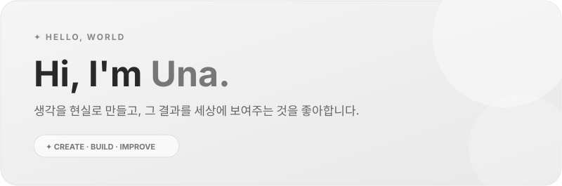
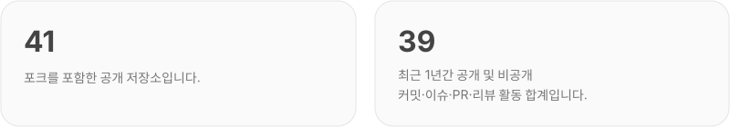

## Featured Projects

## Products &amp; Experiences

<strong>Inuna</strong> · 출시 심사 중 — 자세히 보기

## Languages in My Repositories

제 저장소의 코드가 어떤 언어로 이루어져 있는지 보여드립니다.

## How I Build

활동을 바탕으로 한 작업 기록입니다.

Designed to build, learn &amp; keep moving ✦

